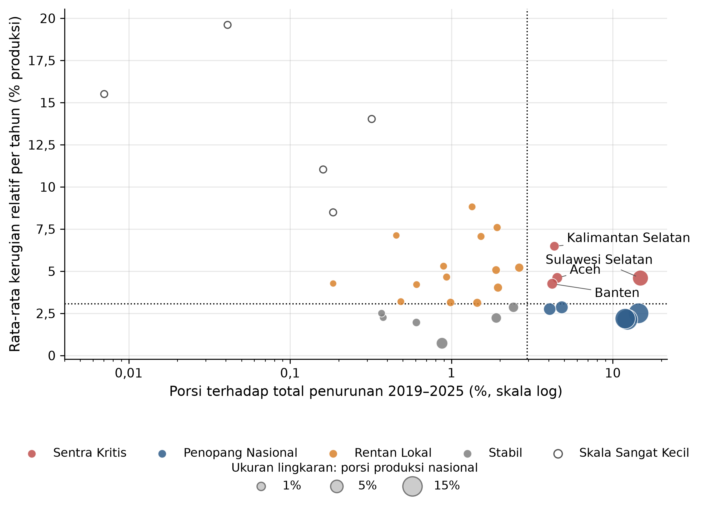
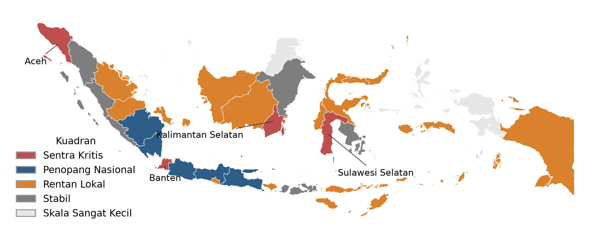

# Skenario Stres Penurunan Produksi Padi Indonesia

Estimasi *Value-at-Risk* (VaR) dan *Tail Value-at-Risk* (TVaR) agregat penurunan produksi padi 34 provinsi
periode 2018–2025 dengan model risiko kolektif. Hasilnya dipakai untuk menyusun skenario stres, matriks
prioritas provinsi, dan level risiko.

## Metode singkat

- **Frekuensi** `N`: banyaknya provinsi yang produksinya turun dalam setahun (2019–2025, 7 observasi).
- **Severitas** `X`: besarnya penurunan produksi per provinsi dalam ton gabah kering giling (125 observasi).
- **Agregat** `S = X₁ + … + X_N`, dengan `N ~ Poisson` dan `X ~ Weibull` (dipilih dari 3 dan 5 kandidat).
- Estimasi parameter dengan *maximum likelihood*, uji kesesuaian dengan *parametric bootstrap*, pemilihan model
  dengan AICc, uji independensi dengan permutasi eksak.
- VaR dan TVaR dari simulasi Monte Carlo (1.000 replikasi × 200.000 skenario), lengkap dengan *Monte Carlo Error*.

Tambahan di `src/skenario.py`: skenario stres (pola penurunan tahun tertentu diterapkan ke produksi 2025),
matriks prioritas provinsi, pita ketidakpastian parameter (*parametric bootstrap*), dan uji balik level risiko.

## Hasil utama

VaR dan TVaR agregat penurunan produksi (juta ton GKG, rata-rata 1.000 replikasi):

| Tingkat kepercayaan | VaR | TVaR |
|---|---:|---:|
| 90% | 2,74 | 3,30 |
| 95% | 3,15 | 3,68 |
| 99% | 4,01 | 4,52 |
| 99,9% | 5,17 | 5,66 |

- Model final: `N ~ Poisson(λ = 17,857)` dan `X ~ Weibull(τ = 0,6355; θ = 68.245,79)`.
- Penurunan agregat 2019 (4,71 juta ton) berada di antara VaR 99% dan 99,9%.
- Pengulangan pola 2019 pada produksi 2025 menghasilkan penurunan 4,73 juta ton (level Ekstrem).
  Empat sentra yang turun serentak sebesar penurunan terburuknya menghasilkan 2,81 juta ton.
- Sentra kritis: Sulawesi Selatan, Aceh, Kalimantan Selatan, Banten.
- Ketidakpastian parameter besar karena hanya ada tujuh observasi tahunan: VaR 99% berkisar 2,81–5,52 juta ton
  (persentil 2,5–97,5 dari 1.000 *bootstrap*).

Level risiko memakai ambang VaR dari model: Normal (< 2,74), Waspada (2,74–3,15), Tinggi (3,15–4,01),
Ekstrem (≥ 4,01 juta ton GKG).




## Struktur

```
data/
  produksi_padi.xlsx      produksi padi 34 provinsi, 2018–2025 (ton GKG)
  provinsi_34.geojson     batas 34 provinsi untuk peta
src/
  analisis.py             analisis utama: data → kecocokan distribusi → simulasi → VaR/TVaR
  skenario.py             skenario stres, matriks prioritas, pita parameter, uji balik
  crm.py                  fungsi model risiko kolektif yang dipakai skenario.py
  gambar.py               matriks prioritas dan peta
output/
  hasil_analisis.xlsx     seluruh tabel hasil analisis.py
  skenario.xlsx           tabel hasil skenario.py
  gambar/                 gambar hasil
assets/
  kerangka.svg            diagram kerangka UKUR–PRIORITASKAN–ANTISIPASI
  alur_penelitian.svg     diagram alur penelitian
tests/                    pengujian fungsi dan replikasi hasil
```

## Menjalankan

```
pip install -r requirements.txt
python src/analisis.py     # sekitar 5–10 menit
python src/skenario.py     # sekitar 1–2 menit
pytest
```

`analisis.py` dan `skenario.py` memakai seed tetap, sehingga hasilnya sama setiap kali dijalankan. `skenario.py`
berhenti bila estimasi ulang berbeda dari hasil `analisis.py`, jadi jalankan keduanya dengan data yang sama.

## Data

- Produksi padi tahunan per provinsi dari Badan Pusat Statistik (BPS), dalam ton gabah kering giling.
  Provinsi hasil pemekaran Papua 2022 digabung ke provinsi induknya sehingga seluruh tahun memakai 34 provinsi.
- Batas wilayah dari [GADM](https://gadm.org) versi 4.1, disederhanakan dengan `shapely` (toleransi 0,01°).
